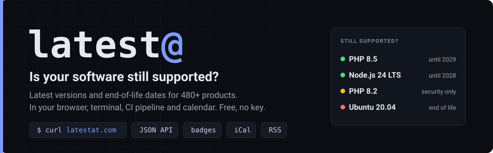
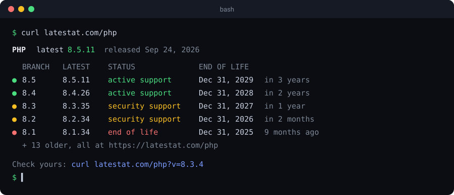

<p align="center">
  <a href="https://latestat.com"></a>
</p>

<p align="center">
  <a href="https://latestat.com"><b>Website</b></a> ·
  <a href="https://latestat.com/stack"><b>Check my stack</b></a> ·
  <a href="https://latestat.com/eol"><b>EOL calendar</b></a> ·
  <a href="https://latestat.com/api"><b>API</b></a> ·
  <a href="#-examples"><b>Examples</b></a>
</p>

<p align="center">
  <a href="https://latestat.com/php"></a>
  <a href="https://latestat.com/nodejs"></a>
  <a href="https://latestat.com/python"></a>
  <a href="https://latestat.com/ubuntu"></a>
  <a href="https://latestat.com/postgresql"></a>
  <a href="https://latestat.com/windows-server"></a>
  <br><sub>☝️ These badges are live. They update themselves, and you can put one in your own README.</sub>
</p>

---

**[latestat.com](https://latestat.com)** answers one question for 480+ products: *is the version I'm running still supported, and for how long?* Languages, databases, operating systems, frameworks, server software, self-hosted apps and devices, refreshed automatically every few hours.

Free. No ads, no account, no API key.

## ⚡ Try it in your terminal



```bash
curl latestat.com/php                 # any product: nodejs, ubuntu, proxmox, windows-server…
curl "latestat.com/php?v=8.3.4"       # am I up to date?
curl latestat.com/eol                 # what reaches end of life in the next 90 days
```

Works with curl, wget, HTTPie and PowerShell. No flags, no `-L`, nothing to install.

## 📋 Grade your whole stack

Paste what you run into **[Check my stack](https://latestat.com/stack)** and get an A–F report you can share. Every report has its own link, image, badge, JSON and calendar feed.

<p align="center">
  <a href="https://latestat.com/stack?s=php:8.5.11,nodejs:24.21.0,postgresql:16.4,ubuntu:20.04,wordpress:6.8.1,proxmox:9.0"></a>
</p>

## 🧰 Everything you can do

<table>
<tr>
<td width="50%" valign="top">🔎 <b><a href="https://latestat.com/php?v=8.3.4">Check a version</a></b><br>Add <code>?v=</code> to any product page. You'll see if you're current, how many releases behind you are, and what to upgrade to.</td>
<td width="50%" valign="top">📅 <b><a href="https://latestat.com/api">Calendar feeds</a></b><br>Subscribe in Outlook, Google or Apple Calendar to end-of-life dates for everything, one product, a curated list or just your stack.</td>
</tr>
<tr>
<td width="50%" valign="top">🔌 <b><a href="https://latestat.com/api">JSON API</a></b><br>Every product and branch with support and end-of-life dates. HTTPS, CORS enabled, no key.</td>
<td width="50%" valign="top">🏷️ <b><a href="https://latestat.com/api">README badges</a></b><br>Live latest-version badges. Pin a branch and the badge turns red when it reaches end of life.</td>
</tr>
<tr>
<td width="50%" valign="top">🗓️ <b><a href="https://latestat.com/eol">EOL calendar</a></b> and <b><a href="https://latestat.com/eol/2027">yearly lists</a></b><br>What stops getting updates soon, and everything ending in 2027, month by month.</td>
<td width="50%" valign="top">⚖️ <b><a href="https://latestat.com/ubuntu/22.04-vs-24.04">Side-by-side comparisons</a></b><br>Ubuntu 22.04 vs 24.04, PHP 8.3 vs 8.4 and more, with the upgrade path.</td>
</tr>
<tr>
<td width="50%" valign="top">✅ <b><a href="https://latestat.com/windows-server/2016#checklist">Migration checklists</a></b><br>Step-by-step upgrade plans that save your progress, starting with Windows Server 2016 → 2025.</td>
<td width="50%" valign="top">📰 <b><a href="https://latestat.com/feed.xml">RSS</a></b> and <b><a href="https://latestat.com/updates">monthly updates</a></b><br>New releases as they land, and a monthly roundup of what shipped and what reached end of life.</td>
</tr>
<tr>
<td width="50%" valign="top">💻 <b><a href="https://latestat.com/check-version">Version commands</a></b><br>The command that prints the version of 250+ tools, ready to copy.</td>
<td width="50%" valign="top">📖 <b><a href="https://latestat.com/glossary">Glossary</a></b><br>LTS, LTSC, ESR, ESU and "security support" in plain English.</td>
</tr>
</table>

## 🔌 API in 30 seconds

```bash
curl -s https://latestat.com/api/php.json | jq -r .latest.version          # 8.5.11
curl -s https://latestat.com/api/php.json | jq '.cycles[] | {cycle, status, eol}'
curl -s "https://latestat.com/api/stack.json?s=php:8.3.20,nodejs:24.1.0" | jq .grade
```

| Endpoint | Returns |
| :--- | :--- |
| `/api/products.json` | Every product with its latest version and release date |
| `/api/{product}.json` | Every branch: `status` (`active`, `security`, `eol`), latest version, support and end-of-life dates |
| `/api/stack.json?s=product:version,…` | A graded report for several products at once |

<details>
<summary><b>Example branch from <code>/api/php.json</code></b></summary>

```json
{
  "cycle": "8.5",
  "release_date": "2025-11-20",
  "latest": "8.5.11",
  "latest_date": "2026-09-24",
  "lts": false,
  "status": "active",
  "status_label": "Active Support",
  "support_until": "2027-12-31",
  "eol": "2029-12-31"
}
```
</details>

<details>
<summary><b>Badges, calendar feeds and RSS URLs</b></summary>

**Badges.** Live latest version; add `?cycle=` to pin a branch (red once it reaches end of life):
```markdown
[](https://latestat.com/nodejs)
[](https://latestat.com/php/8.3)
```

**Calendar feeds (iCal):**
- Everything: `https://latestat.com/eol.ics`
- One product: `https://latestat.com/php/eol.ics`
- Curated lists: `/homelab.ics`, `/sysadmin.ics`, `/wordpress-stack.ics`
- Just your stack: `https://latestat.com/stack.ics?s=php:8.3,ubuntu:22.04`

**RSS:** `https://latestat.com/feed.xml` (everything) or `https://latestat.com/php/feed.xml` (one product)
</details>

Please cache responses for a few minutes; the data changes every few hours, not every second.

## 🧪 Examples

Copy-paste scripts that check your stack and **exit 1 if anything is past end of life**, so they can gate a deploy or run on a schedule.

| File | Use it for |
| :--- | :--- |
| [`github-actions/eol-check.yml`](examples/github-actions/eol-check.yml) | ⭐ A GitHub Actions workflow that fails the build and re-checks every Monday, with a summary table |
| [`check-eol.sh`](examples/check-eol.sh) | Bash + jq, for cron jobs and servers |
| [`Check-Eol.ps1`](examples/Check-Eol.ps1) | PowerShell 5.1 / 7, for Windows admins |
| [`check_eol.py`](examples/check_eol.py) | Python, standard library only |
| [`latest-version.mjs`](examples/latest-version.mjs) | JavaScript (Node 18+ or the browser) |

```bash
./examples/check-eol.sh php:8.3.20 nodejs:24.1.0 ubuntu:22.04
```

## 👋 About

latest@ is built and run by **[Brandon Sheley](https://sheley.org)**, an IT specialist in Topeka, Kansas with 20+ years in web infrastructure. Pages for software he runs day to day include his own notes.

Also by Brandon: **[sheley.org](https://sheley.org)** (IT toolkit and homelab write-ups) · **[OldPCGuy](https://oldpcguy.com)** (plain-English help for older Windows PCs)

**Found a wrong date or want a product added?** [Open an issue](../../issues/new). If latest@ saves you a lookup, a ⭐ helps other people find it.

<sub>Example code in this repo is MIT licensed. The data on latestat.com is free to use; a link back is appreciated.</sub>
